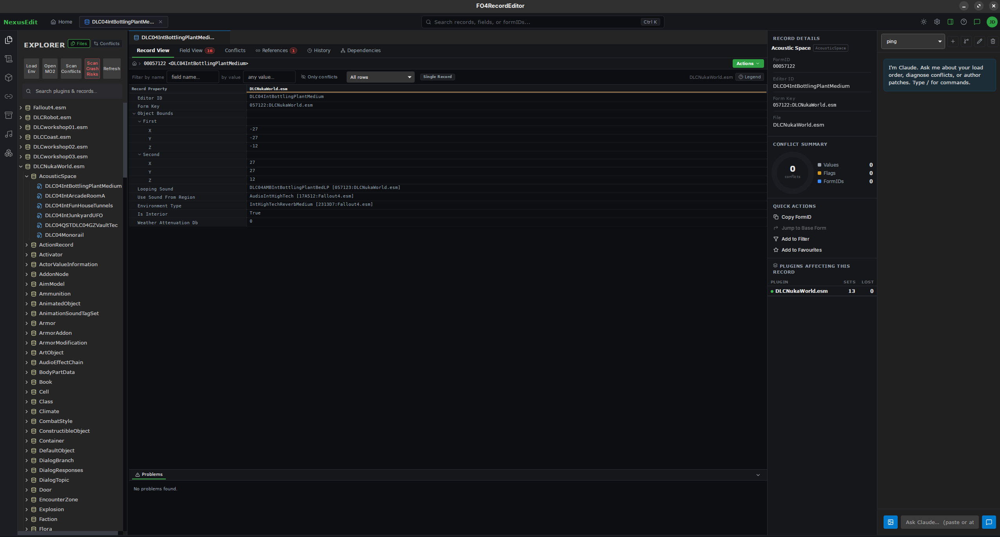
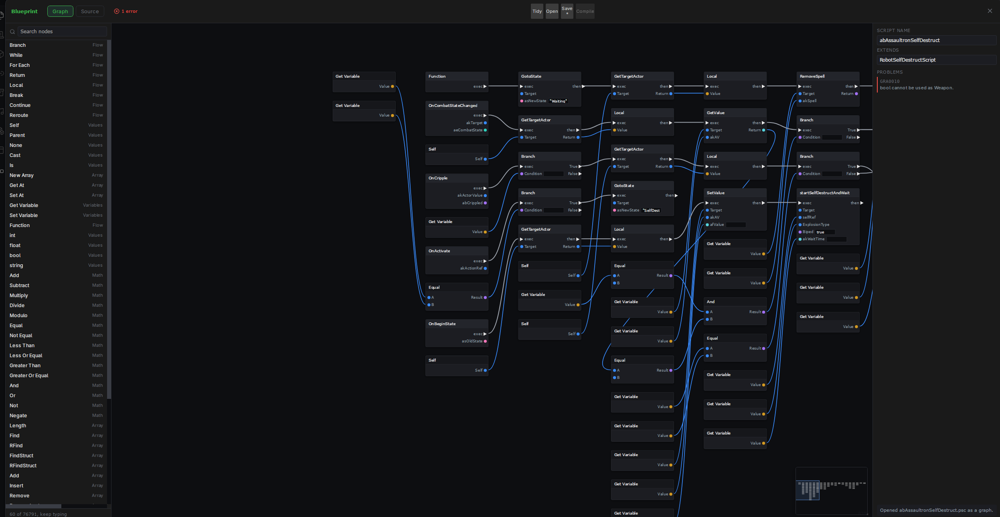
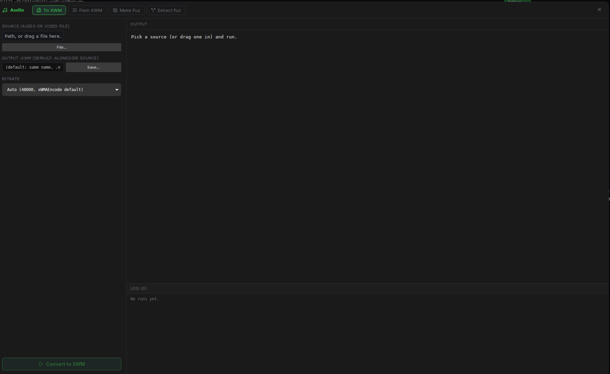
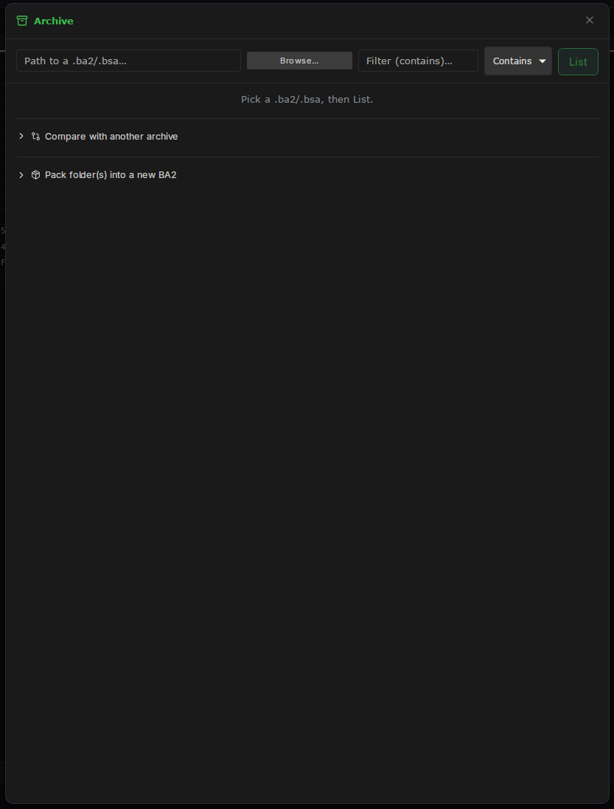
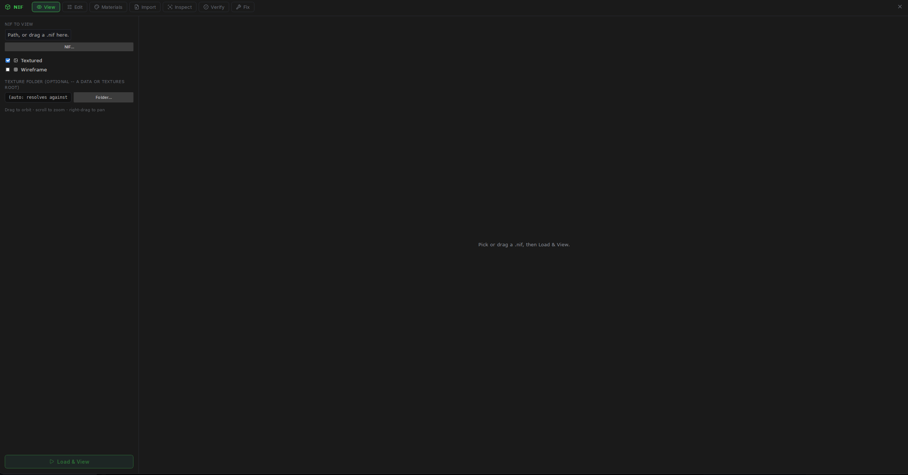
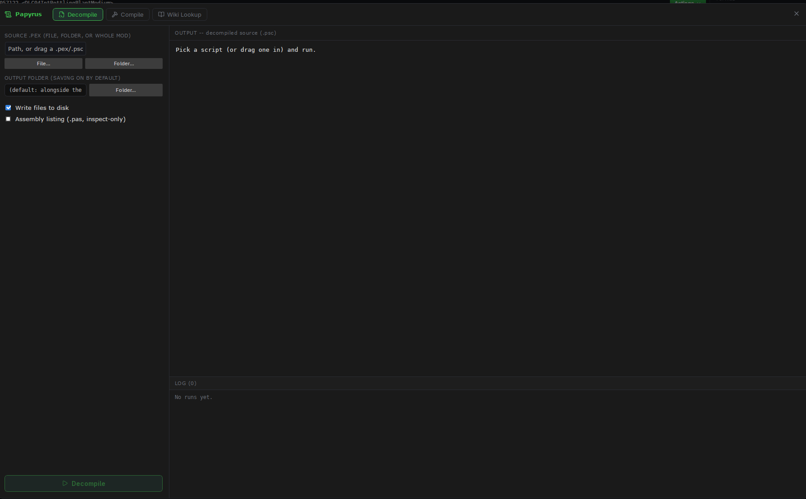
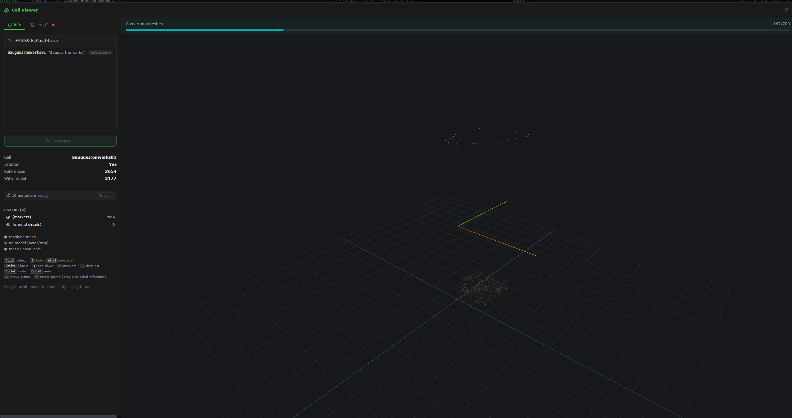

# FO4IDE

FO4IDE is a native C++23 Fallout 4 plugin IDE that reads and writes real `.esp`/`.esm`/`.esl`
files. Two things live in one executable:

- a **desktop editor** for browsing records across your load order, diffing and editing them,
  scanning conflicts, compiling and decompiling Papyrus, inspecting NIFs, and viewing cells
- a **native MCP server** that exposes the same plugin, Papyrus, archive, material, audio, NIF,
  and analysis operations to external AI clients over stdio

Plugin parsing, mutation, FormID/master remapping, conflict analysis, and archive handling are backed
by **Radicle**, the C++ Fallout 4 plugin SDK in this repository. The shipped application does not
require Mutagen, xEdit, or the .NET runtime.

The historical C# implementation is retained in the source tree only while native parity and
regression coverage are completed. It is not the runtime backend used by the native host.

## Screenshots

The record editor, the visual Papyrus editor, and the game-asset panels. Click any image for the
full-size version.

| | | |
|---|---|---|
| [](images/editor.png)<br>Record editor | [](images/blueprint.png)<br>Blueprint editor | [](images/audio-panel.png)<br>Audio panel |
| [](images/archive-panel.png)<br>Archive panel | [](images/nif-viewer.png)<br>NIF viewer | [](images/papyrus-decompile.png)<br>Papyrus panel |
| [](images/cell-viewer.png)<br>Cell viewer | | |

## Install on Windows

1. Ensure the **Microsoft Edge WebView2 Runtime (x64)** is installed. It is already present on most
   current Windows 10/11 systems.
2. Install the **Microsoft Visual C++ 2015-2022 Redistributable (x64)** if it is not already present.
3. Unzip the package anywhere, keeping the folder together. The executable loads `web\dist\` and
   optional helper tools from beside itself.
4. Run `FO4RecordEditor.exe`.

`FO4RecordEditor.exe` is now the native C++ host. The historical executable name is intentionally
preserved so existing MO2 launch entries and MCP client configurations do not need to change.

If you are editing a plugin that overrides mods, launch FO4IDE through **Mod Organizer 2**
(Settings -> Executables -> Add from file). The native MO2 profile loader reads the active profile,
resolves the real mod paths in priority order, and uses MO2's overwrite directory as the only
trusted location for automatically-created patch plugins.

No .NET runtime is required.

## Linux

Build the native `.deb` with:

```bash
PluginEditTool/packaging/linux/build-deb.sh 1.0.0
```

or install a package produced by that script. Linux has no embedded window: `fo4recordeditor` starts
the same C++ backend, serves the UI on a loopback port and opens it in your default browser. See
[docs/internal/RUNNING_ON_LINUX.md](docs/internal/RUNNING_ON_LINUX.md).

A few optional helper tools such as texconv, Archive2, PapyrusCompiler, or xWMAEncode may still be
Windows-only. Wine can be useful for panels that invoke those external programs. Plugin editing,
load-order analysis, Radicle archive support, the built-in Papyrus engine, and MCP do not require
Wine.

## AI integration through MCP

The native host does not embed a model-provider/session backend. AI inference and conversation
storage belong to the external client. FO4IDE exposes its native tool surface over MCP instead.

Start the stdio server with:

```text
FO4RecordEditor.exe --mcp
```

The full setup guide is in **[docs/MCP_SETUP.md](docs/MCP_SETUP.md)**. A minimal client config looks
like this:

```jsonc
{
  "mcpServers": {
    "fo4editor": {
      "type": "stdio",
      "command": "C:\\Tools\\FO4RecordEditor\\FO4RecordEditor.exe",
      "args": ["--mcp", "--mo2", "C:\\Modlists\\My Modlist"]
    }
  }
}
```

- `--mcp` runs the C++ host headless as a stdio MCP server.
- `--mo2 <instance>` points it at an MO2 instance and active profile.
- Without `--mo2` the server starts empty; the `open_plugin` tool loads a plugin by path.

The editor's AI panel is a handoff panel for this native MCP workflow. Actions such as
`Ask AI: what breaks?` place their generated prompt there for copying into an MCP-connected client.

## Visual scripting

Papyrus scripts can be edited as node graphs: events, branches, calls, variables, and execution
flow wired together instead of edited only as text. The native Papyrus engine handles parsing,
analysis, PEX generation/decompilation, and graph integration.

## Configuration

Settings live in `%APPDATA%\FO4RecordEditor\settings.json` on Windows and the normal XDG config
location on Linux. Paths are optional and can be configured from the UI. Tool-specific environment
variables include `TEXCONV_PATH`, `PAPYRUS_COMPILER_PATH`,
`PAPYRUS_BASE_IMPORTS`, `CK_WIKI_PATH`, `FFMPEG_PATH`, `XWMAENCODE_PATH`, and `ARCHIVE2_PATH`.

The built-in Papyrus compiler does not require `PapyrusCompiler.exe`, but compiling scripts that
import vanilla game scripts still requires those `.psc` sources on the import path.

## Package layout

Windows release packages use this layout:

```text
FO4RecordEditor.exe     native C++ editor + MCP server
radicle.dll             Radicle backend (C++ API + C ABI); must stay beside the exe
web\dist\               React UI loaded by WebView2
tools\                  optional external helper programs
sdk\                    Radicle C ABI headers and the import library
mcp.sample.json         sample MCP client configuration
docs\MCP_SETUP.md       MCP setup and tool-surface documentation
```

The executable looks for `web\dist\` beside itself first, which keeps packaged builds independent
of the source checkout. Radicle is linked as `radicle.dll`, so the editor starts only when that DLL
is in the same folder.

## Deploying a build

The deployed copy comes from CI, not from a local build. `native-ci.yml` job
**FO4IDE package (Windows, MSVC, shared Radicle)** builds the shared configuration on the Windows
runner, checks that the executable imports `radicle.dll`, checks that `radicle_abi_version()` matches
`RADICLE_ABI_VERSION`, runs the native MCP smoke, and uploads the release package as the
`fo4ide-package` artifact.

To deploy:

1. Download the `fo4ide-package` artifact of the `nomad/dev` run.
2. Back up the current install:
   `Copy-Item -Recurse E:\Tools\FO4IDE\FO4IDE E:\Tools\FO4IDE\backup-<timestamp>`.
3. Replace the folder with the package contents (the `FO4RecordEditor-<date>` folder's contents,
   including `radicle.dll` and `web\dist`).
4. Verify the backend and the tool surface:
   `python -c "import ctypes; l=ctypes.CDLL(r'E:\Tools\FO4IDE\FO4IDE\radicle.dll'); l.radicle_abi_version.restype=ctypes.c_uint32; print(l.radicle_abi_version())"`
   must print the `RADICLE_ABI_VERSION` of that commit, and the MCP tool list must contain the
   tools the build claims (ask the client for `tools/list`, or run
   `PluginEditTool\native\tests\native_mcp_smoke.py` against the deployed executable).

## Building from source

### Windows

Build prerequisites:

- Visual Studio 2022 with the Desktop development with C++ workload
- CMake 3.25+
- Python 3
- Node.js/npm
- Git and internet access for pinned CMake FetchContent dependencies

Build the UI and native host with `publish.bat`, or create a release zip with `package.ps1`.
Both scripts build C++ with CMake and do not invoke `dotnet`.

`publish.bat [deploy-folder]` also copies the build into that folder (for example an MO2 tools
folder); the folder can come from `FO4IDE_DEPLOY_DIR` instead, and with neither it only builds.
`package.ps1` bundles helper programs. texconv and ffmpeg are always included: when `-TexconvPath`
(`TEXCONV_PATH`) is unset, or `-AudioToolsDir` (`FO4IDE_AUDIO_TOOLS_DIR`) has no `ffmpeg.exe`, the
build downloads the pinned version listed in `tools/bundled-tools.json` and checks its SHA256. An
override that is not a file stops the build. The other helpers come from `-CkWikiPath`
(`CK_WIKI_PATH`), the rest of `-AudioToolsDir`, and, with
`-IncludeBaseScripts`, `-BaseScriptsPath` (`FO4IDE_BASE_SCRIPTS_DIR`). Any of those that is unset is
skipped with a warning, and the package still works without it.

A direct native build is also available:

```powershell
cmake -S native -B native/build/release -G "Visual Studio 17 2022" -A x64 `
  -DFO4IDE_BUILD_TESTS=OFF
cmake --build native/build/release --config Release --target fo4ide
```

### Linux

Install a C++23 toolchain, CMake/Ninja, Python 3 and Node/npm (plus `dpkg-deb` and `fakeroot` for the
`.deb`), then run `packaging/linux/build-deb.sh` or configure `native/` directly with CMake. No GTK or
WebKit packages are needed.

For architecture and plugin-format work, start at
[docs/internal/README.md](docs/internal/README.md) and
[docs/internal/ARCHITECTURE.md](docs/internal/ARCHITECTURE.md).

## License

GPL-3.0. See [LICENSE](LICENSE) and [THIRD_PARTY_NOTICES.md](THIRD_PARTY_NOTICES.md) for the
component list. The package contains no Bethesda game assets; it reads the files from the user's
installed game and mod setup.