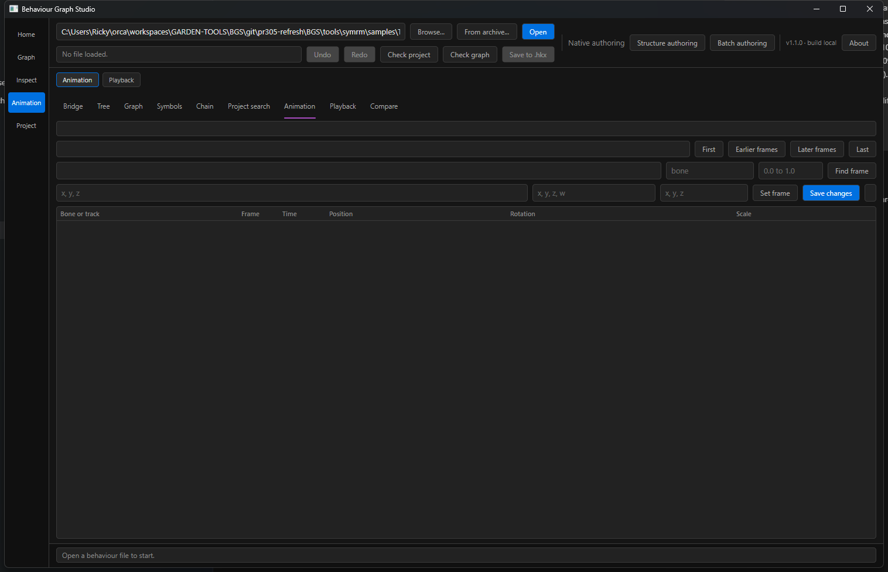
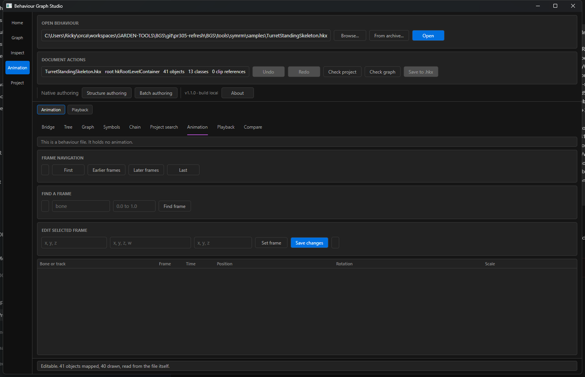
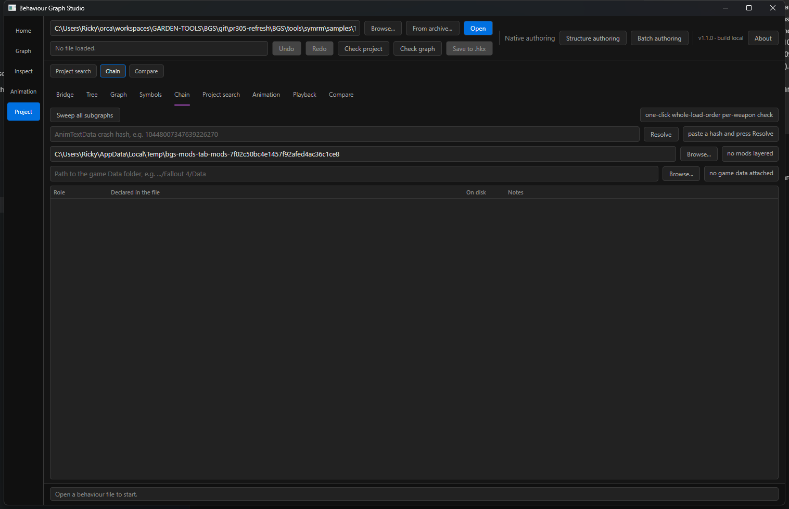
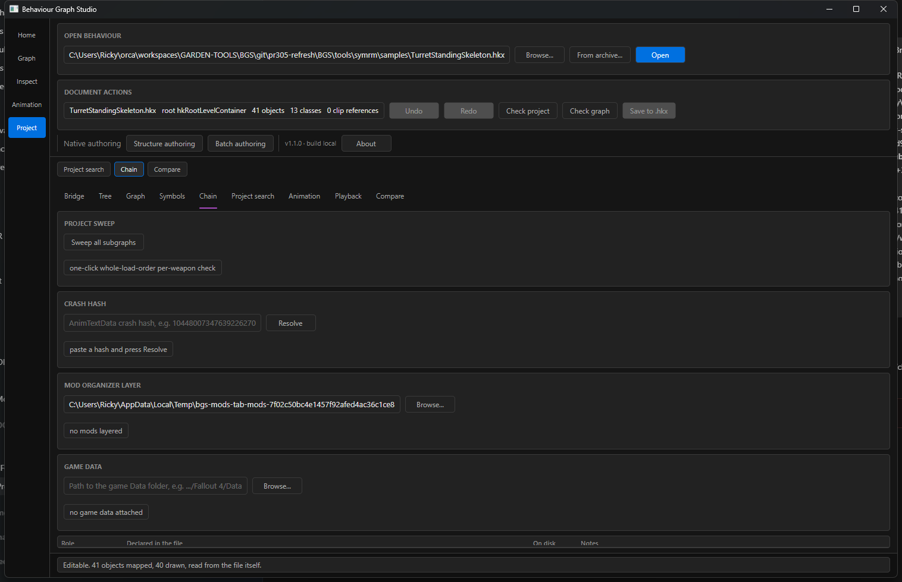
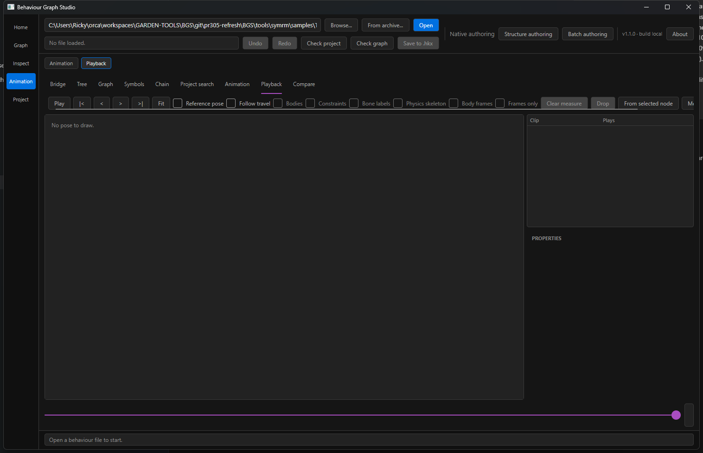
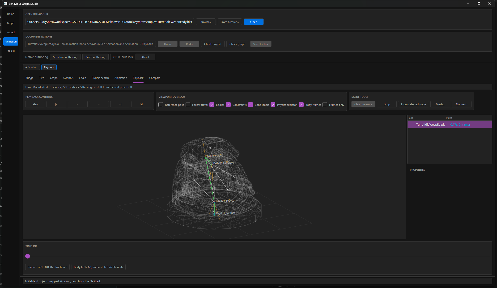
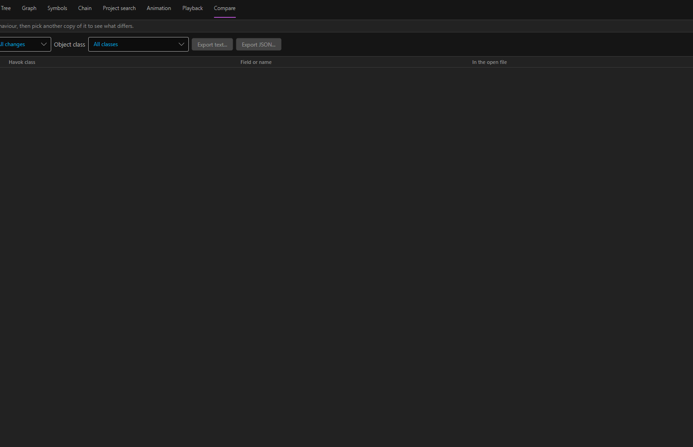
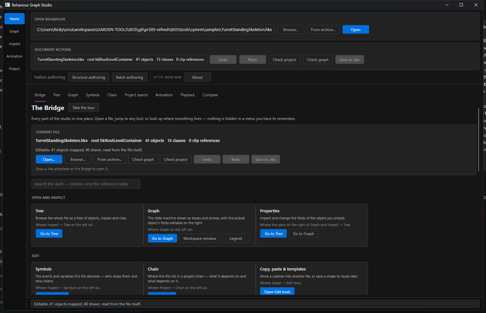

# BGS UI layout evidence

## Root cause

The affected screens reused a `DockPanel` helper that pushed every secondary control to the right edge of one row. Long summaries, text fields, and action buttons therefore competed for the same horizontal space. The shared button and field primitives also had no minimum height, so the controls read as compressed even at the normal window size.

## Changes

- Added shared minimum control sizing and centered content alignment.
- Constructed grouped layouts at the owning Build* and EditorShell sites instead of walking the runtime visual tree.
- Stacked the command groups and responsive authoring tools while keeping the status footer owned by EditorShell.
- Grouped Animation frame navigation, frame search, and frame editing.
- Grouped Playback controls, viewport overlays, scene tools, and timeline.
- Split Chain browse/resolve inputs from their status pills so long labels no longer squeeze the action row.
- Kept existing control instances, click handlers, validation, and save workflows unchanged.

## Visual evidence

| Surface | Before | After |
| --- | --- | --- |
| Animation |  |  |
| Chain |  |  |
| Playback |  |  |
| Command and footer |  |  |

## Verification

- Rebased onto `origin/main` at `5e58f9a1` before editing.
- `dotnet build app/BehaviourStudio.csproj --configuration Release --no-restore` passed with 0 warnings and 0 errors.
- `dotnet run --project tools/uismoke/uismoke.csproj --configuration Release --no-restore -- --layout-smoke` completed successfully.
- Focused smoke passed command grouping, status-footer ownership, Playback/Animation/Chain sections, the Playback Play handler, and the command Check graph handler.
- Desktop inspection at 2105x1220 confirmed the Animation, Playback, Chain, and command/footer layouts. Playback loaded the real vanilla `TurretMounted.nif` with its matching `TurretMountedSkeleton.hkx` from Fallout 4 archives; the project NIF reader reported 1 drawable shape, 2291 vertices, and 5162 edges with 0.00 rest-pose drift.
- `git diff --check` passed; no `//` comments were added.
- The broader UI smoke battery reached its initial assertions but did not exit in this workspace; it was stopped after the focused smoke completed successfully.

## Remaining layout debt

Other tabs still use the older single-row `Bar` helper in Graph filtering, Project search, and Compare. They were left unchanged because this pass found no regression there.
