# Architecture

## How the tools relate

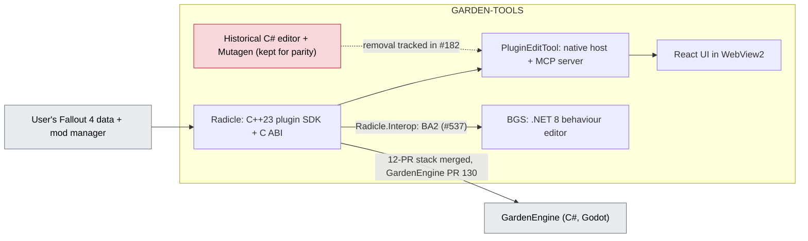

Solid arrows are what exists on `main`; dotted arrows are in progress or planned. Red nodes are the duplicated layers below.

## Layers and who owns them

| Layer | Owner today | Other copies | Note |
| --- | --- | --- | --- |
| Plugin container, FormKey, master remap, load-order and conflict graph | Radicle | Historical C# editor uses Mutagen. Load-order list files (plugins.txt, loadorder.txt, Fallout4.ccc) are still parsed by PluginEditTool `Mo2ProfileLoader` (Mutagen), by GardenEngine `GameLoader`/`Mo2ProfileLoader` (its own parser) and by BGS `src/Archive`; adoption tracked in [#539](https://git.nomadicinteractive.dev/GARDEN/GARDEN-TOOLS/issues/539), [#540](https://git.nomadicinteractive.dev/GARDEN/GARDEN-TOOLS/issues/540) and [garden-engine/GardenEngine #389](https://git.nomadicinteractive.dev/garden-engine/GardenEngine/issues/389) | Radicle owns list-file parsing and assembly since [#538](https://git.nomadicinteractive.dev/GARDEN/GARDEN-TOOLS/issues/538) (C ABI 40, `Radicle/docs/LOAD_ORDER_FILES.md`); the runtime index table stays caller-supplied ([#28](https://git.nomadicinteractive.dev/GARDEN/GARDEN-TOOLS/issues/28)). F4LODGEN was removed in #495 |
| BA2 reading | Radicle (GNRL and DX10, versions 1, 7 and 8, #394; C# `Radicle.Interop.Ba2Archive`) | none: BGS `Ba2.cs` is a thin wrapper over `Radicle.Interop` since [#537](https://git.nomadicinteractive.dev/GARDEN/GARDEN-TOOLS/issues/537) | Decided in [#346](https://git.nomadicinteractive.dev/GARDEN/GARDEN-TOOLS/issues/346): option 3, Radicle is the shared archive layer |
| C ABI for other languages | Radicle (`c_api.h`; PR #322, merged, adds the environment ABI) | none | Consumed by PluginEditTool and by GardenEngine since its PR #130 (2026-10-03) |
| Records and edits UI | PluginEditTool | BGS has its own tree/graph editor for `.hkx` | Different file types |
| NIF | PluginEditTool NIF viewer (uses an external `niftool` and native code), BGS `src/Nif`, F4LODGEN BTR/BTO writer | GardenEngine's own `niftool` (nifly) | Four NIF touchpoints with different scopes |
| AI/MCP surface | PluginEditTool (`--mcp`), BGS assistant docs (`BGS/docs/ai-mcp-integration.md`) | none | Separate servers |

## Radicle internals

`Radicle/docs/ARCHITECTURE.md` describes a layered library with no FO4IDE, Mutagen or CLR dependency. Unknown bytes are never dropped: an uncertain field stays in the raw subrecord and is listed in `docs/OPEN_QUESTIONS.md`.

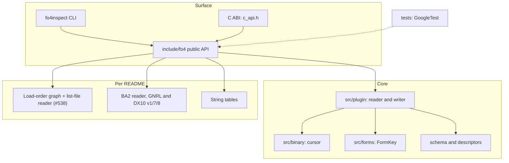

Labels are short on purpose. Details: `src/binary` is a bounds-checked little-endian cursor; `src/forms` resolves and encodes FormKeys; the schema is `schema/fallout4/fields.json` with generated field descriptors; `tools/inspect` is the JSON `fo4inspect` CLI; tests run GoogleTest against synthetic and real plugins.

The layer list is from `docs/ARCHITECTURE.md`, which still marks the load-order graph, archive reader and schema modules as future work; the README says they are implemented. The README is the newer of the two, so the diagram groups them separately.

Identity is the part that must not be mixed up. Two FormID spaces exist: plugin-relative on disk, and runtime load-order. Radicle's identity is a symbolic `FormKey`, never a raw load-order FormID. A FormKey looks like `00009A:RadiationOverhaul.esp`.

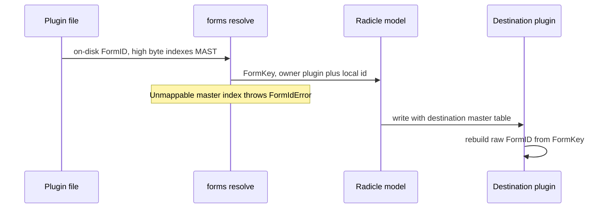

High bytes are never fixed up: a master index that cannot be mapped is an error, not a guess.

Sources: [Radicle/docs/ARCHITECTURE.md](https://git.nomadicinteractive.dev/GARDEN/GARDEN-TOOLS/src/branch/main/Radicle/docs/ARCHITECTURE.md) · [Radicle/README.md](https://git.nomadicinteractive.dev/GARDEN/GARDEN-TOOLS/src/branch/main/Radicle/README.md) · [Radicle/docs](https://git.nomadicinteractive.dev/GARDEN/GARDEN-TOOLS/src/branch/main/Radicle/docs) (`FORMID_MODEL.md`).

## PluginEditTool inside the native host

The README describes one executable, `FO4RecordEditor.exe`, that is both a desktop editor and a stdio MCP server (`--mcp`, with `--mo2 <instance>` or `--data <folder>`). Plugin parsing, mutation, FormID/master remapping, conflict analysis and archives are backed by Radicle. The runtime needs no Mutagen, xEdit or .NET; the older C# projects stay in the tree until native parity and regression coverage are complete. Settings live in `%APPDATA%\FO4RecordEditor\settings.json` (Windows).

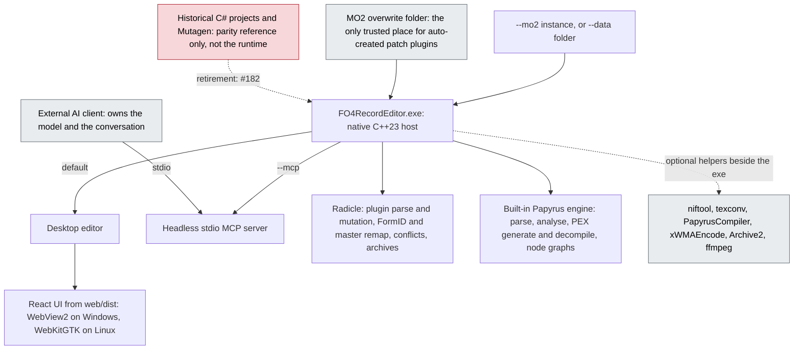

The AI panel inside the editor is only a handoff: it places a generated prompt there for copying into an MCP-connected client. The host embeds no model or session backend.

Source: [PluginEditTool/README.md](https://git.nomadicinteractive.dev/GARDEN/GARDEN-TOOLS/src/branch/main/PluginEditTool/README.md).

## F4LODGEN process model

From `F4LODGEN/docs/ARCHITECTURE.md`: `f4lod_core` (deterministic C++20 library) below a headless CLI/worker `f4lodgen`, with a separate desktop UI (Tauri 2 + React preferred) that is only a client of the worker. Data flow: game data resolver (plugins, loose files, BA2 with real archive precedence) to an immutable record graph, then terrain and object models to BTR and BTO plus DDS, then validation, manifest and packaging. Unsupported binary layouts fail closed.

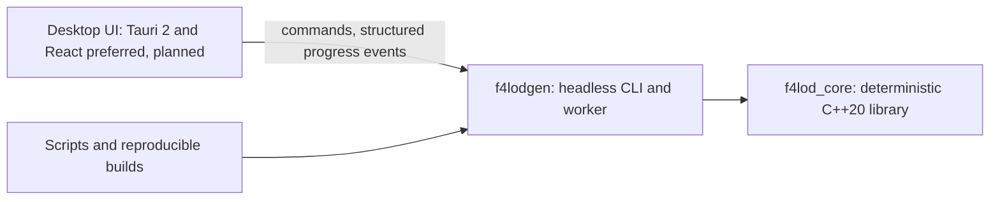

Every desktop operation must also be expressible in the CLI. The worker boundary lets large mesh and texture jobs restart independently of the UI.

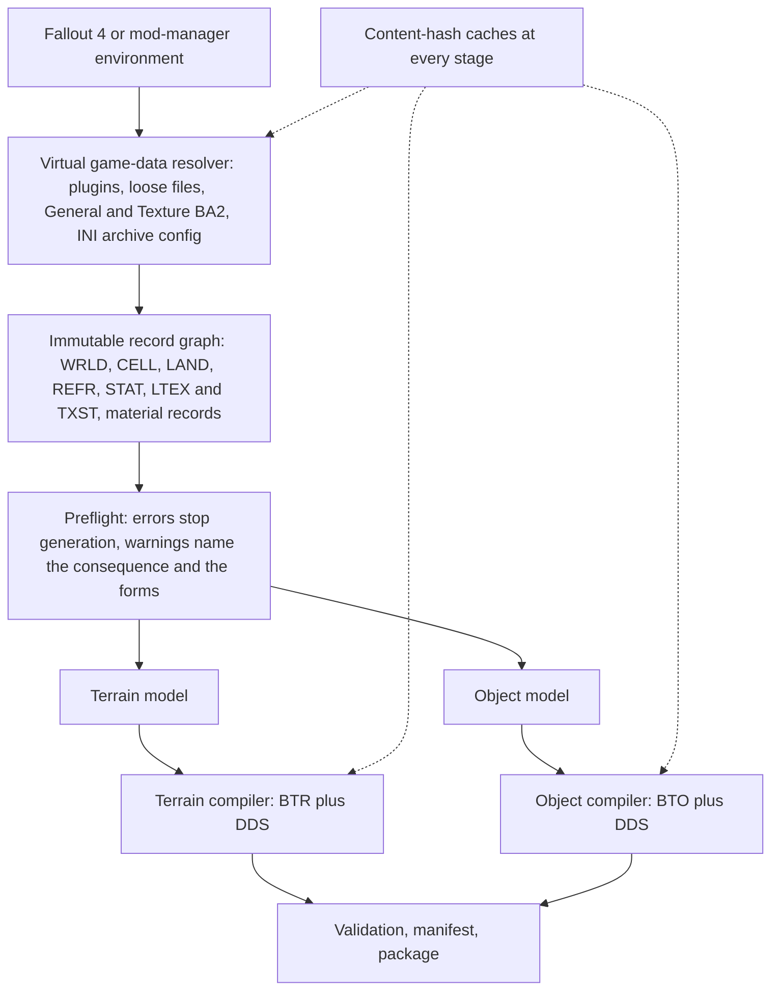

The document's own ASCII data flow leaves out preflight; its section 3 defines preflight as a compiler phase over the record graph, so it is placed before the two models here. That placement is my reading, not a diagram in the source.

Terrain, from the same document:

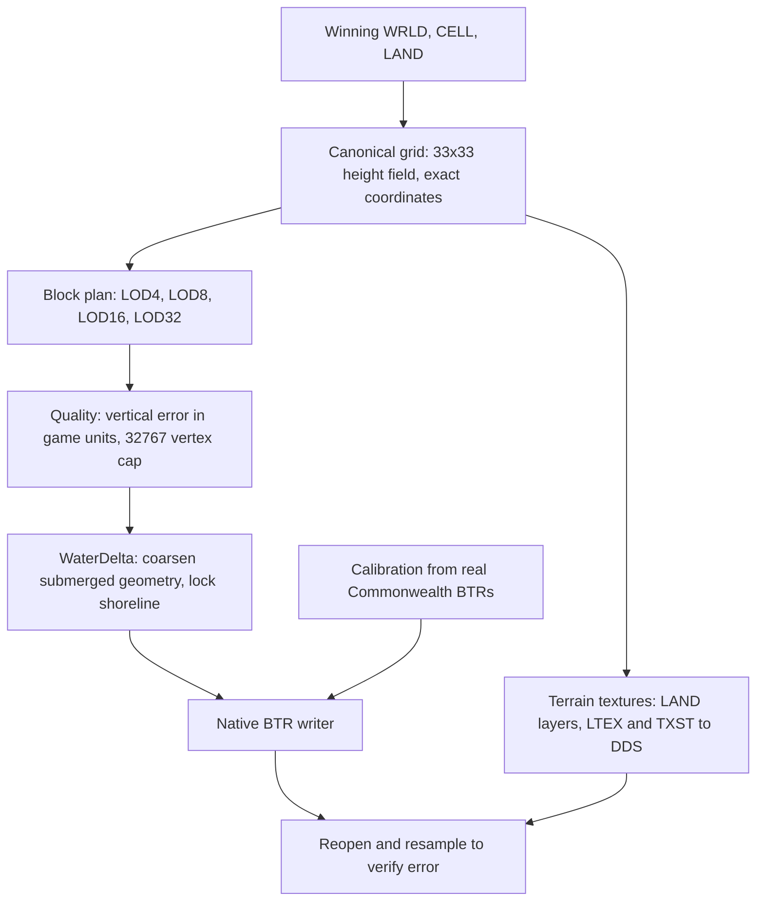

Details behind the short labels: shared edge samples are validated before simplification; block names and coordinates come from the real LODSettings southwest anchor, not `(0,0)`; `Quality=-1` keeps full geometry for LOD4 only, other values are the maximum Z deviation; `meshoptimizer` is the reduction engine but the visible contract is measured terrain error; `WaterDelta=-1` disables the underwater stage; the BTR writer is driven by measured semantics, and unsupported real-game structures fail closed; terrain textures need full mip chains, explicit colour space and content-hash caching.

Objects: each reference is classified, then an authored LOD asset is chosen in a fixed order. Generated LOD models are an additional source only in v0.2.

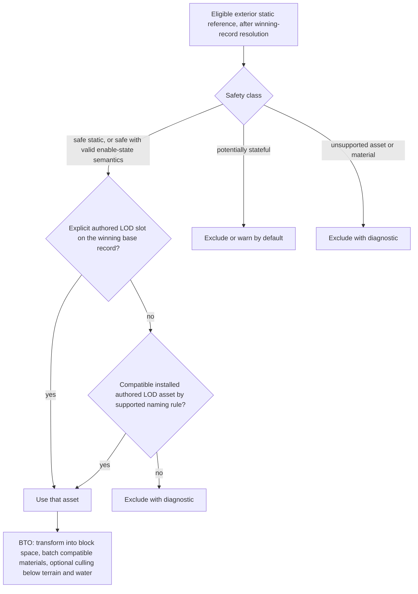

Quest meaning is never inferred from EditorID strings alone. Plugin mutation is not in v0.1; a later patch writer produces new output plugins and never edits source plugins in place.

Source: [F4LODGEN/docs/ARCHITECTURE.md](https://git.nomadicinteractive.dev/GARDEN/GARDEN-TOOLS/src/branch/main/F4LODGEN/docs/ARCHITECTURE.md).

## BGS: safe editing and headless scans

Behaviour Graph Studio is a .NET 8 desktop editor for Fallout 4 Havok behaviour `.hkx` files. Its rule is the same as the others: an edit that cannot be written safely is refused and the source is left unchanged.

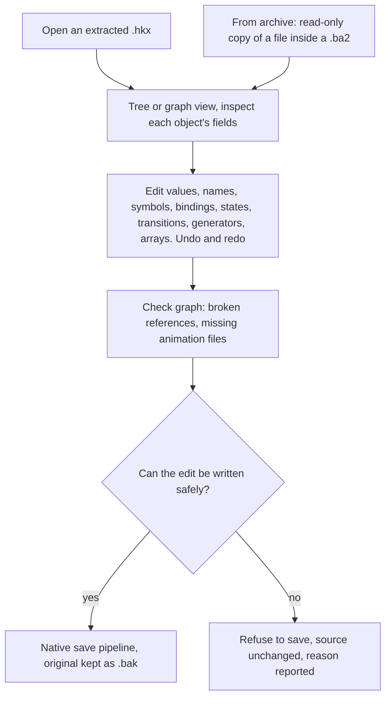

Files opened from a `.ba2` are read-only; copy one to a folder you control before editing. The same tool can scan a whole load order without opening the window:

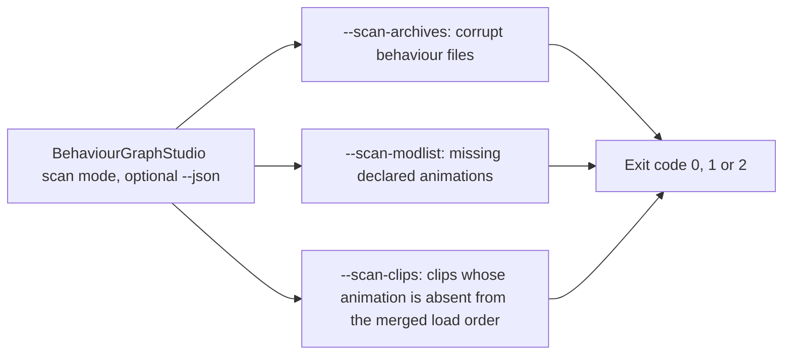

The scans are static findings, not a reproduction of the game's runtime load path. Source: [BGS/README.md](https://git.nomadicinteractive.dev/GARDEN/GARDEN-TOOLS/src/branch/main/BGS/README.md).

## Fail-closed rule (shared)

Radicle, BGS and F4LODGEN all state the same policy: unsupported or unproven layouts are refused or left opaque, never guessed, and writes are staged with a backup. When adding a feature, prove the layout from runtime, Creation Kit or reverse-engineering evidence first (Radicle's evidence order in `Radicle/ROADMAP.md`).

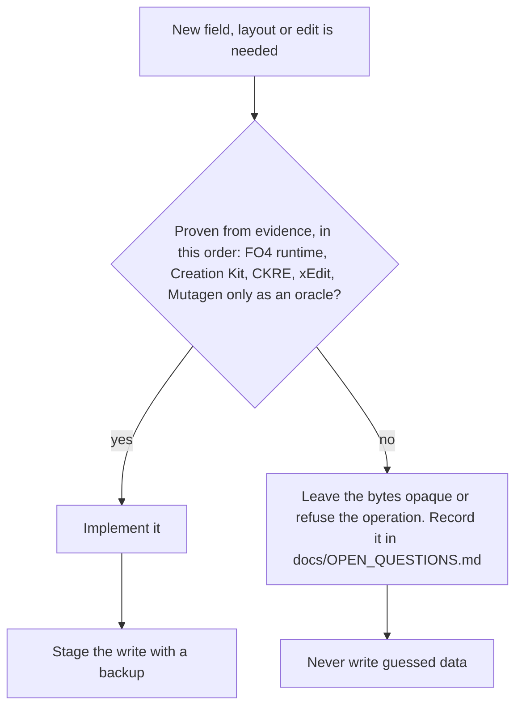

How each tool applies it: Radicle preserves unknown bytes, BGS keeps a `.bak` and refuses unsafe saves, and F4LODGEN writes to temporary files and publishes validated output atomically.

## Known stale documentation

- Root `README.md`: describes PluginEditTool as "native host, Mutagen core, web UI", which contradicts `PluginEditTool/README.md`; lists `Resources/RE-Work/` (absent); omits BGS.
- `Radicle/README.md` and `Radicle/ROADMAP.md`: link to GitHub milestones and say Radicle replaces Mutagen "inside FO4IDE" only; the larger workload is the GardenEngine stack.
- `BGS/README.md`: links to a GitHub Pages guide and GitHub Issues that predate the Forgejo move.
- All tracked in [#338](https://git.nomadicinteractive.dev/GARDEN/GARDEN-TOOLS/issues/338).
