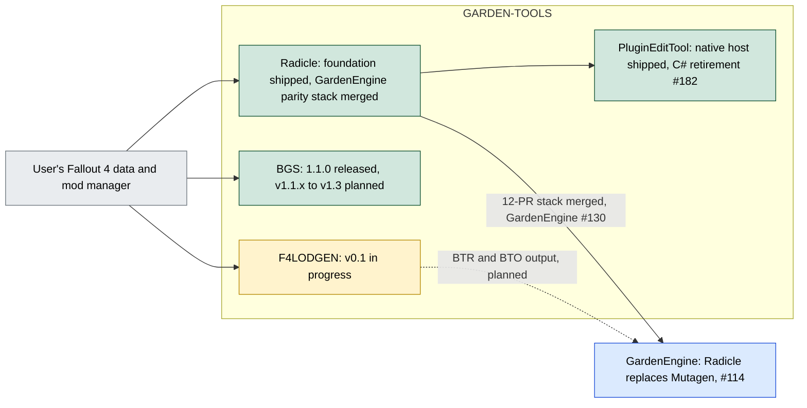

# GARDEN-TOOLS

Native tools used across GARDEN projects. Four tools live here; the root `README.md` still lists three of them plus a `Resources/RE-Work/` folder that is not in the repository (audit issue [#338](https://git.nomadicinteractive.dev/GARDEN/GARDEN-TOOLS/issues/338)).

## The tools

| Tool | What it is | Stack | Where | Status |
| --- | --- | --- | --- | --- |
| **Radicle** | Fallout 4 plugin SDK: lossless `.esp/.esm/.esl` container, FormKey identity, master remap, load-order and conflict graph, stable C ABI, BA2 reader, localized strings | C++23, CMake, namespace `fo4` | `Radicle/` | Foundation shipped; GardenEngine parity stack merged 2026-09-29 to 2026-10-02 and in use by GardenEngine PR #130 |
| **PluginEditTool** (also called FO4IDE; executable `FO4RecordEditor.exe`) | Desktop plugin editor plus an MCP server in one executable: record editor, conflicts, Papyrus compile/decompile, NIF viewer, cell viewer, archive/audio panels | native C++23 host, React UI in WebView2 (`web/`); historical C# kept for parity (`FO4RecordEditor*`, `Mutagen/`) | `PluginEditTool/` | Native host is the shipped runtime; C# retirement is issue #182 |
| **BGS** (Behaviour Graph Studio) | Standalone editor for Fallout 4 Havok behaviour `.hkx`: inspect, edit, validate, compare, preview animation; headless load-order scanning | .NET 8, Windows and Linux | `BGS/` | 1.1.0 released; v1.1.x, v1.2, v1.3 planned |
| **F4LODGEN** | Fallout 4 LOD compiler (terrain BTR, object BTO, textures) driven by real game data | C++20 core `f4lod_core`, CLI `f4lodgen`, Tauri UI planned | `F4LODGEN/` | v0.1 in progress per its roadmap (dated 2026-08-18) |

The same four tools with status colours. Green is shipped, amber is in progress, blue is a consumer outside this repository.

BGS and F4LODGEN read game data through their own readers rather than Radicle; that duplication is what [#346](https://git.nomadicinteractive.dev/GARDEN/GARDEN-TOOLS/issues/346) asks the team to decide on, and it is drawn out on the Architecture page.

## Pages

| Page | What it answers |
| --- | --- |
| [Repo Map](https://git.nomadicinteractive.dev/GARDEN/GARDEN-TOOLS/wiki/Repo-Map) | Where does each part of the repo live, how does it build and test, and what are the traps? File-level map of Radicle, PluginEditTool, BGS and CI at nomad/dev 9d6c622c |
| [Architecture](https://git.nomadicinteractive.dev/GARDEN/GARDEN-TOOLS/wiki/Architecture) | How do the tools relate, and where do they duplicate each other? Also the internals of Radicle, PluginEditTool, F4LODGEN and BGS as diagrams |
| [Radicle-GardenEngine-Parity](https://git.nomadicinteractive.dev/GARDEN/GARDEN-TOOLS/wiki/Radicle-GardenEngine-Parity.-) | What was the 12-PR stack that replaced Mutagen in GardenEngine, in what order did it land, and what is still missing? |
| [Roadmap](https://git.nomadicinteractive.dev/GARDEN/GARDEN-TOOLS/wiki/Roadmap) | Milestones, the Radicle phases, the F4LODGEN dependency chain (with current issue numbers), BGS versions, and open decisions |
| [Radicle-Overview](https://git.nomadicinteractive.dev/GARDEN/GARDEN-TOOLS/wiki/Radicle-Overview) | What is Radicle, what is in each folder, how is it built and tested, and where does it stand? Start here for the C++ core. |
| [Radicle-Plugins-Records-and-Checks](https://git.nomadicinteractive.dev/GARDEN/GARDEN-TOOLS/wiki/Radicle-Plugins-Records-and-Checks) | How does Radicle read, edit and write plugins and records, how do schema and codegen work, and what do the Problems checks detect? |
| [Radicle-Papyrus-Status](https://git.nomadicinteractive.dev/GARDEN/GARDEN-TOOLS/wiki/Radicle-Papyrus-Status) | What can the Radicle Papyrus compiler, decompiler and graph lifter do today, and what is still missing? |
| [Radicle-SWF-and-AVM-Status](https://git.nomadicinteractive.dev/GARDEN/GARDEN-TOOLS/wiki/Radicle-SWF-and-AVM-Status) | What can Radicle do with SWF files and AVM1/AVM2 code today? |
| [Radicle-Asset-Formats-Status](https://git.nomadicinteractive.dev/GARDEN/GARDEN-TOOLS/wiki/Radicle-Asset-Formats-Status) | What can Radicle do with BA2, NIF, materials, textures, audio, SEQ and strings? |
| [FO4IDE-PluginEditTool-Overview](https://git.nomadicinteractive.dev/GARDEN/GARDEN-TOOLS/wiki/FO4IDE-PluginEditTool-Overview) | How is the FO4IDE / PluginEditTool editor built, from the web UI down to Radicle, and what does the MCP server expose? |
| [FO4IDE-Features-and-Status](https://git.nomadicinteractive.dev/GARDEN/GARDEN-TOOLS/wiki/FO4IDE-Features-and-Status) | Which FO4IDE panels and features work, are partial, or are unverified? |
| [Dev-Workflow-Build-Test-CI](https://git.nomadicinteractive.dev/GARDEN/GARDEN-TOOLS/wiki/Dev-Workflow-Build-Test-CI) | How do I build, test and run CI for Radicle and PluginEditTool, and which conventions apply? |

## Tracking

- Board: [GARDEN-TOOLS Roadmap](https://git.nomadicinteractive.dev/GARDEN/GARDEN-TOOLS/projects/2), columns are tools and areas; status is on each card.
- Audit: [#338](https://git.nomadicinteractive.dev/GARDEN/GARDEN-TOOLS/issues/338); cross-tool decision: [#346](https://git.nomadicinteractive.dev/GARDEN/GARDEN-TOOLS/issues/346).
- Consumers outside this repo: [GardenEngine #114](https://git.nomadicinteractive.dev/garden-engine/GardenEngine/issues/114) (Radicle replaces Mutagen).

## Licences

`PluginEditTool` is GPL-3.0 (its README). BGS has its own `LICENSE` file. Radicle and F4LODGEN have no LICENSE file at their folder roots in the listings read for this page; check before reusing code across tools.

## Scope and evidence

Written **2026-09-28** from `main` at `94b5c46`; the Radicle status was updated **2026-10-03** after the stack and GardenEngine #130 merged; the tool READMEs and roadmaps, and the open pull requests. No tool was built or run for this page. Several READMEs still link to GitHub locations from before the move to Forgejo.
