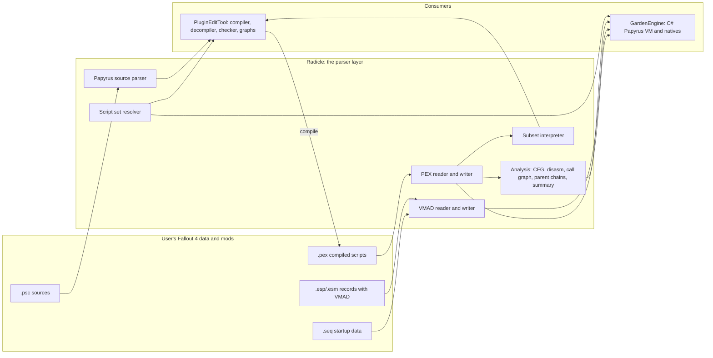

# How Papyrus works and where it's at

## The simple version

Papyrus is Fallout 4's scripting language. A modder writes a script as text (`.psc`), Bethesda's compiler turns it into bytecode (`.pex`), and the game runs that bytecode. Scripts are attached to game records — a quest, an actor, a terminal — through a `VMAD` block, and to quest stages through fragments. They react to events like `OnInit` and `OnActivate`, keep variables and properties, and call the engine's native functions.

This repository does not try to be Fallout 4. It tries to be a trustworthy toolkit around Papyrus data. Today it can:

- **Read and write compiled scripts exactly.** Radicle's `.pex` reader/writer reproduces real files byte for byte: 4,581 of the 4,581 readable files in the local corpus round-trip identically.
- **Work out which script wins.** When several mods ship the same script name, Radicle resolves the winner with the load-order rules: a loose file beats an archive, a higher load order beats a lower one.
- **Read and edit what a record attaches.** Scripts, properties, arrays, structs and quest fragments stored in a record's `VMAD` can be read and edited.
- **Analyse scripts without running them.** Disassembly, control-flow graph, call graph, parent chains, "what does this script call / read / write", and mapping a quest fragment to the function it runs.
- **Run a small part of Papyrus.** Radicle has a C++ interpreter for simple compiled functions (maths, strings, arrays, calls, properties, states). It has no game engine and no natives; it is a building block, not a game runtime.
- **Compile source without the Creation Kit.** PluginEditTool (FO4IDE) has its own Papyrus compiler, decompiler and checker, so `.psc` → `.pex` works with no `PapyrusCompiler.exe`.
- **Run scripts inside GardenEngine.** GardenEngine has its own C# Papyrus VM with a large library test suite, but it is not yet wired to one live game session and still has many unproven behaviour keys.

What is not there yet: a full game-compatible VM (latent functions, events, registrations and timers, save/load, the engine's native functions), struct support in Radicle's interpreter, a C ABI for that interpreter, and GardenEngine actually consuming the newest Radicle script, call-graph and VMAD read exports — its Radicle pin is still on an old ABI.

## Where it's at, at a glance

| Question | Short answer |
| --- | --- |
| Can we read/write `.pex`? | Yes, byte-exact, Fallout 4 format 3.9, 47 opcodes. |
| Can we read/write `.psc`? | Radicle parses `.psc` (lexer, parser, summary); PluginEditTool compiles and decompiles it. |
| Can we read/edit `VMAD`? | Yes for the known grammar: leading scripts and properties, scalar values, arrays, struct counts, quest and scene fragments. Unknown variants stay opaque and refuse edits. |
| Can we tell which script wins? | Yes: script set resolver over loose roots and archives, with `replaced` counts. |
| Can we analyse scripts? | Yes: disassembly, CFG, call graph, parent chains, summaries, fragment mapping. |
| Can we execute Papyrus? | Partly. Radicle has a subset interpreter (C++ only); GardenEngine has a fuller C# VM, not yet in a live session. |
| Is the engine using all of this? | Not yet. The new exports are on `nomad/dev` at ABI 56; GardenEngine still pins ABI 9 and the port is open. |

The important split: Radicle owns the binary formats and the analysis; PluginEditTool owns authoring (source to `.pex`, `.pex` back to source); GardenEngine owns execution.

## Technical: the language and the file formats

### Papyrus itself

- A script is an object with a name and a parent script. It can declare **states** (a named state shadows the empty state for the same function name), **properties** (auto properties backed by a hidden variable, or full properties with `Get`/`Set` handlers), **variables**, **events** and **functions**.
- Fallout 4 adds **structs** and the struct opcodes (`struct_create`, `struct_get`, `struct_set`, `array_findstruct`, `array_rfindstruct`), and **custom events**.
- A function body is a sequence of instructions over a small typed value model: `None`, `String`, `Integer`, `Float`, `Bool`, `Object`, `Array` (and `Struct` in Fallout 4). Integer arithmetic wraps, integer division truncates toward zero, string equality is case-insensitive, and float comparison uses the VM epsilon.
- Calls come in three shapes: `callmethod` (receiver expression plus function name), `callparent` (start the lookup at the parent class), `callstatic` (script name plus function name). All three are variable-argument opcodes.
- The compiler also writes a **string table**, per-object code, debug line information, and user flags. The user-flag table normally comes from `Institute_Papyrus_Flags.flg`, which ships with the Creation Kit; PluginEditTool carries a built-in copy that matches real `.pex` files bit for bit.

### `.pex`: compiled bytecode

Measured facts Radicle relies on (see [PEX_PROVENANCE.md](https://git.nomadicinteractive.dev/GARDEN/GARDEN-TOOLS/src/branch/nomad/dev/Radicle/docs/PEX_PROVENANCE.md)):

- Little-endian, magic `0xFA57C0DE`, Fallout 4 is game id 2 at format 3.9. Foreign game ids and the big-endian Skyrim magic are rejected up front.
- 47 opcodes, including the Fallout 4 additions.
- The per-object `size` field has two conventions in the wild: 1,480 of 1,496 measured loose files count the field's own four bytes, 16 count only the body. `PexObject::sizeIncludesItself` records which one a file used.
- Bytes after the last object are preserved in `PexFile::trailingBytes`; the string table is kept verbatim rather than rebuilt.
- Strings are `u16` length-prefixed, one byte per character. Radicle treats those bytes as Latin-1, which is what makes the corpus round-trip; treating bytes at or above `0x80` as anything else is **unproven** and not implemented.
- The format is not claimed to be fully specified: fields the local corpus never exercised stay unproven.

### `VMAD`: what a record attaches

A record's `VMAD` subrecord stores the script list and its values. Radicle reads and edits the known grammar ([VMAD.md](https://git.nomadicinteractive.dev/GARDEN/GARDEN-TOOLS/src/branch/nomad/dev/Radicle/docs/VMAD.md), [VMAD_VARIABLE_EVIDENCE.md](https://git.nomadicinteractive.dev/GARDEN/GARDEN-TOOLS/src/branch/nomad/dev/Radicle/docs/VMAD_VARIABLE_EVIDENCE.md)):

- Leading scripts with flags, then properties of types 1–5 (object, string, int, float, bool) and array types 11–15, plus struct types 7 and 17.
- **Quest fragments** (script plus function, addressed by a stage and stage index), **PACK / INFO / SCEN** flag-bit bindings, **PERK / TERM** index bindings, and the separate **SCEN phase fragment** list.
- Writing is limited to VMAD versions 5/6 and object formats 1/2. Unknown variants fail closed instead of being guessed: variable type 6, non-empty type 16, nested struct members, array/struct element edits, fragment and alias script property values, and creating a fragment section where none exists are opaque and refuse mutation.
- VMAD string values are UTF-8; names keep the Windows-1252 boundary. Unknown bytes and unedited entries survive serialization byte for byte.
- Variable layouts and runtime binding are still open research ([#520](https://git.nomadicinteractive.dev/GARDEN/GARDEN-TOOLS/issues/520), RE-005); only known properties and the verified empty type 16 are covered.

### `.SEQ` and quest data

Radicle also reads the startup `.seq` data and the stored QUST structure (stages, objectives, aliases) with its fragments, which is what a runtime needs to start quest scripts at the right stage. The stage-fragment list is what `resolve_fragments` maps to a `.pex` function.

## Technical: the Radicle modules

| Module | What it does | C ABI | Status |
| --- | --- | --- | --- |
| `Radicle/include/fo4/pex`, `Radicle/src/pex/pex.cpp` | `.pex` model, reader, writer, string-table rebuild | `radicle_pex_parse/_read_file/_write_bytes/_get_header/_object_*` | Done, byte-exact round trip on the corpus |
| `Radicle/include/fo4/schema/vmad.hpp`, `src/schema/vmad.cpp` | `VMAD` decode, quest/scene extras, strict traversal | `radicle_record_vmad_scripts` (read) | Read covers scripts, scalars, arrays, structs; type 6 / non-empty 16 opaque |
| `Radicle/src/plugin/vmad_writer.cpp`, `vmad_fragment_edits.cpp`, `src/forms/quest_vmad.cpp` | `VMAD` authoring: scripts, properties, quest/scene/perk/terminal fragments | `radicle_plugin_set_vmad_*`, quest fragment set/remove | Edits existing shapes; creating a fragment section is refused |
| `Radicle/include/fo4/pex_analysis/cfg.hpp`, `disasm.hpp`, `summary.hpp`, `fragments.hpp` | CFG, structured/labelled disassembly, "what does this script do", fragment → function | none | C++ only |
| `Radicle/include/fo4/pex_analysis/callgraph.hpp`, `parent_chain.hpp`, `script_set.hpp` | Call graph, parent-chain validation, winning-script resolution | `radicle_pex_callgraph_*`, `radicle_pex_validate_parent_chains`, `radicle_script_set_*` (ABI 55/56) | Merged in #822 |
| `Radicle/include/fo4/papyrus/` | Interpreter, value model, host callbacks, array ops, status codes | none | Subset VM, C++ only |
| `Radicle/include/fo4/papyrus_source/` | `.psc` lexer, parser, summary | none | C++ only |
| `Radicle/include/fo4/seq`, `src/seq/seq.cpp` | `.seq` startup data | `c_api_seq.h` | Done |

Current C ABI on `nomad/dev`: **56** (`RADICLE_ABI_VERSION`). 55 is the script set resolver, 56 the PEX call graph, parent chains and the general VMAD reader; the C# bindings (`RadicleNative.g.cs`) and the layout probe are generated from the headers and committed.

## Technical: the interpreter (what runs and what does not)

The Radicle interpreter is a first working slice over an already-parsed `PexFile`, with no engine and no natives.

**Runs:** arithmetic with wrapping and truncating division; string concat/format/compare; the scalar cast table; relative jumps (`jmp`, `jmpt`, `jmpf`) with target validation; method/static/parent calls with a frame deque (a Papyrus call is not C++ recursion); parent-chain method lookup capped at 64 hops; named states shadowing the empty state; properties through `Host::getProperty`/`setProperty`, auto properties through the backing variable, property handlers as frames; natives through `Host::callNative`; shared-reference arrays; instruction and call-depth budgets; typed `Status` errors.

**Does not run:** latent functions and `Wait`; events and the registration table; every Fallout 4 native (the registry is empty in tree; only tests add entries); garbage collection and object lifetime; save/restore of VM state; and the five struct opcodes, which return `UnsupportedOpcode` because the value model has no struct variant and cannot tell a struct type name from a script type name without the file's struct table.

**Deliberate deviation:** any error stops the whole `Run` and returns `Status` with `None`, which is the dividing function returning `None`. Real Papyrus logs the error and hands `None` back to the caller; resuming would need the engine's error state, so the difference is recorded rather than hidden. Host state is mutated as callbacks happen and is not rolled back.

A C ABI over the interpreter does not exist yet; it would need an owning handle, a C function-pointer `Host`, value constructors/accessors, native registration and a status mapping.

## Technical: the analysis layer

- **CFG** partitions a function into leaders and adds a synthetic exit block, so `return` and falling off the end are ordinary successors. Loops are back edges in a DFS; unreachable blocks are a BFS miss. A jump target outside `[0, instructionCount]` is a typed error.
- **Disassembly** prints a labelled listing, and reconstructs `if`/`while` only for shapes it can prove; `jmpt` short-circuit chains and unprovable loops fall back to labels. It never drops or reorders instructions.
- **Call graph** resolves each call operand the way the compiler emits it: `callmethod` receiver is `args[1]` (`self`, a declared variable type, or the identifier as written), `callparent` uses the caller's parent class, `callstatic` takes script and function names. Resolution is a case-insensitive first-match over the supplied files and never follows the parent chain, so an inherited method called with `callparent` stays unresolved. Property getter/setter bodies are scanned too, with the caller slot recorded as `PropertyRead`/`PropertyWrite`.
- **Parent chains** walk `parentClassName` for every object: `MissingParent`, `Cycle`, `TooDeep` (default depth 64). A seed type from the caller ends a chain, because Radicle has no native-class list; the engine passes its own.
- **Summary** answers "what does this script do" per object: events (call-graph roots), the functions each event calls in order, `GoToState` transitions, properties touched and variables written.
- **Fragment mapping** turns a stored quest stage fragment (script plus function) into the `PexFunctionRef` to run.

Measured on the retail Data folder (from the committed real-data tests, 2026-10-24):

- 10,331 script entries, 10,331 distinct names, 0 replaced on that machine (Creation Club set varies per install).
- Call graph over the official scripts: 30,474 functions (30,385 state functions and 89 property handlers), 122,001 call sites, 88,055 resolved, 39,084 native targets, 33,946 unresolved, 25,680 roots, and 28 call sites whose caller is a property handler.
- Parent-chain walk over 10,271 objects: zero findings with no seeds. The engine's seed configuration is not measured here.
- 4 of the 33,946 unresolved calls are `callparent` sites whose function is declared two or more parents up — the documented cost of not following the chain.

## Technical: PluginEditTool (FO4IDE)

PluginEditTool has the full authoring toolchain, native since the C# retirement work ([#182](https://git.nomadicinteractive.dev/GARDEN/GARDEN-TOOLS/issues/182)):

- Lexer, recursive-descent parser, script index, type model, name resolver, type checker, code generator, Creation Kit fidelity pass, decompiler, symbols/analysis service, and a node-graph compiler/lifter.
- MCP tools: `compile_papyrus`, `decompile_papyrus`, `papyrus_check`, `papyrus_function_lookup`, `papyrus_script_info`.
- **No Creation Kit compiler needed.** `compile_papyrus` picks the built-in engine when no `PapyrusCompiler.exe` is installed (`engine: auto|builtin|creationkit`). It still needs the vanilla base script **sources** on the import path to resolve `Form`, `ObjectReference`, `Actor` and friends — that is a weaker requirement than the CK binary but not "compiles from nothing".
- Evidence: differential-tested against `PapyrusCompiler.exe` as a black-box oracle; a vanilla sweep of 7,854 source files parsed with 0 unparseable and 0 flagged by the duplicate-declaration check; the `.pex` corpus round trip is 4,581/4,581 byte-identical.
- Known gaps, stated in [PAPYRUS.md](https://git.nomadicinteractive.dev/GARDEN/GARDEN-TOOLS/src/branch/nomad/dev/PluginEditTool/docs/internal/PAPYRUS.md): array built-in argument types are unchecked (counts are checked at code generation); override checking compares parameter count only; no definite-assignment or all-paths-return analysis; `GetMatchingStructs` is refused; the `array_findstruct` member-name operand type is reasoned from the format, not measured.

## Technical: the GardenEngine runtime

GardenEngine is the consumer that actually executes scripts. Its own wiki is the authority ([Papyrus Runtime](https://git.nomadicinteractive.dev/garden-engine/GardenEngine/wiki/Papyrus-Runtime.-), tracker [#27](https://git.nomadicinteractive.dev/garden-engine/GardenEngine/issues/27)); the state below is from its 2026-10-08 audit:

- A C# VM over `.pex` bytecode: explicit frame stack, no recursion on the C# stack, instruction-budgeted scheduler, one shared `ScriptHost`, evidence-gated natives, optional synchronous C# overrides that are always reported.
- `OnInit` runs after properties are initialized, behind a Garden ordering barrier; this is Garden policy, not proven vanilla ordering. A failed `OnInit` leaves the script failed closed.
- Native target contract: static calls need a global, instance calls need an attached `ScriptObject` of the right script, engine-object calls never guess an attached script from a bare reference.
- Library status: 522/522 Papyrus tests, zero failures or skips; the evidence registry validates 144 rows with 0 problems — 23 PROVEN, 67 ENGINE_POLICY, 4 APPROXIMATED, 1 CONTRADICTED, **49 UNPROVEN**. No full Fallout compatibility is claimed.
- Not wired yet: one production `GameSession`/`ScriptHost` across played and streamed cells (#213/#215); the complete effective-load-order coverage baseline (#218) is missing; the real `Message.Show` PR is paused; 8 of 46 Papyrus runtime tasks are closed.
- Clean-room rules: Radicle is the only Bethesda binary parser, script caches are generated locally from the user's own data, and no Bethesda or mod script payload is committed or redistributed. Bethesda tools are black-box oracles only.
- GardenEngine pins Radicle at ABI 9 (`34d16d50`) as of that audit. The script set resolver, call graph, parent chains and VMAD reader landed in GARDEN-TOOLS #822 at ABI 56, so the engine-side re-pin and port are still open work.

## Technical: what just landed and what is next

**Landed in GARDEN-TOOLS #822 (merged 2026-10-26, `nomad/dev` `b78d27ec1`, ABI 54 → 56):**

- Script set resolver: which `.pex` wins per name, with the optional per-root load index and `replaced` counts.
- PEX call graph and parent-chain validation over the C ABI.
- General record VMAD reader: scripts, properties, scalar values, array elements, struct members.
- `radicle_assets_root_count`, and property-handler call sites in the call graph.

This closed steps 1 and 2 of the plan on [#821](https://git.nomadicinteractive.dev/GARDEN/GARDEN-TOOLS/issues/821). Still open there, in the order the issue proposed:

1. **Interpreter core** — struct opcodes and `GotoState`, then a C ABI skeleton (create runtime, load a `.pex` set, run a function) with `Host` callbacks and a default-allow evidence gate.
2. **Resumable VM** — slices, latent suspend/resume, scheduler, budgets.
3. **Instances and registrations** — owner id, instance table, `OnInit` barrier, event queue, timer and custom-event registrations, native and override registries.
4. **Save state** — record types, versioned serialization, digest, `.pex` fingerprint, restore report. Real frame serialization is new design, not a port.
5. **Quest rules** — startup stage helper, property shape binding, alias fill decision.

Engine-side follow-ups (GardenEngine): re-pin past ABI 56, delete `ScriptCachePrecedence` and `ArchiveScriptSource`'s parallel selection in favour of `radicle_script_set_read`, run the call-graph and parent-chain exports against the census and `LoadOrderAcceptance` before swapping them in, and rewrite `VmadValueBinder` / `ScriptAttachments` against `radicle_record_vmad_scripts`. The engine still calls none of the new exports.

Other open questions tracked elsewhere: VMAD variable layouts and non-empty type 16 (RE-005 / [#520](https://git.nomadicinteractive.dev/GARDEN/GARDEN-TOOLS/issues/520)); Papyrus fidelity gaps in PluginEditTool ([#78](https://git.nomadicinteractive.dev/GARDEN/GARDEN-TOOLS/issues/78)); GardenEngine's remaining runtime tasks (#208–#245); and the repository-level Radicle licence/provenance decision noted in `PEX_PROVENANCE.md`.

## Sources

- `Radicle/docs/PEX_PROVENANCE.md` — where the `.pex` reader/writer came from, what is measured, what is not claimed.
- `Radicle/docs/VMAD.md` and `Radicle/docs/VMAD_VARIABLE_EVIDENCE.md` — the `VMAD` editing matrix and the variable-layout evidence.
- `Radicle/docs/OPEN_QUESTIONS.md` — question 17 (VMAD fragments and variables), 20c (dialogue/scene payloads).
- `Radicle/docs/FO4_PARITY.md` — the per-area parity rows, including the VMAD and quest rows.
- `Radicle/docs/code-notes/Radicle.md` — the anchored notes for every module above (interpreter, CFG, disassembly, call graph, summaries, fragments, script set, VMAD read/write).
- `PluginEditTool/docs/internal/PAPYRUS.md` — the FO4IDE compiler/decompiler engineering record, corpus numbers and known gaps.
- GardenEngine wiki: [Papyrus Runtime](https://git.nomadicinteractive.dev/garden-engine/GardenEngine/wiki/Papyrus-Runtime.-), [VM](https://git.nomadicinteractive.dev/garden-engine/GardenEngine/wiki/Papyrus-Runtime-VM.-), [Coverage](https://git.nomadicinteractive.dev/garden-engine/GardenEngine/wiki/Papyrus-Runtime-Coverage.-), [Roadmap](https://git.nomadicinteractive.dev/garden-engine/GardenEngine/wiki/Papyrus-Runtime-Roadmap.-), [Evidence](https://git.nomadicinteractive.dev/garden-engine/GardenEngine/wiki/Papyrus-Runtime-Evidence.-), [Save and Load](https://git.nomadicinteractive.dev/garden-engine/GardenEngine/wiki/Papyrus-Runtime-Save-and-Load.-), [Events and Registrations](https://git.nomadicinteractive.dev/garden-engine/GardenEngine/wiki/Papyrus-Runtime-Events-and-Registrations.-), [Quest System](https://git.nomadicinteractive.dev/garden-engine/GardenEngine/wiki/Papyrus-Runtime-Quest-System.-).

## Scope and evidence

Written **2026-10-26** against GARDEN-TOOLS `nomad/dev` `b78d27ec1` (Radicle ABI 56) and the GardenEngine Papyrus wiki as audited **2026-10-08**. No tool was built or run for this page: the Radicle numbers come from the committed real-data tests and code notes, and the GardenEngine numbers from its own audit records. The corpus figures are from the owner's machine and are not repository artifacts; corpus files stay local and private.