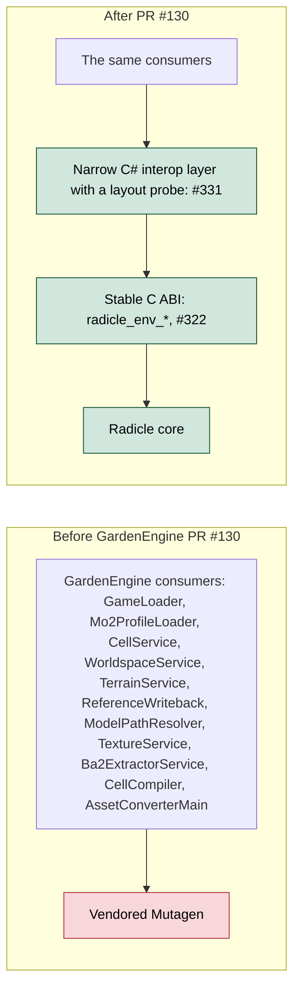
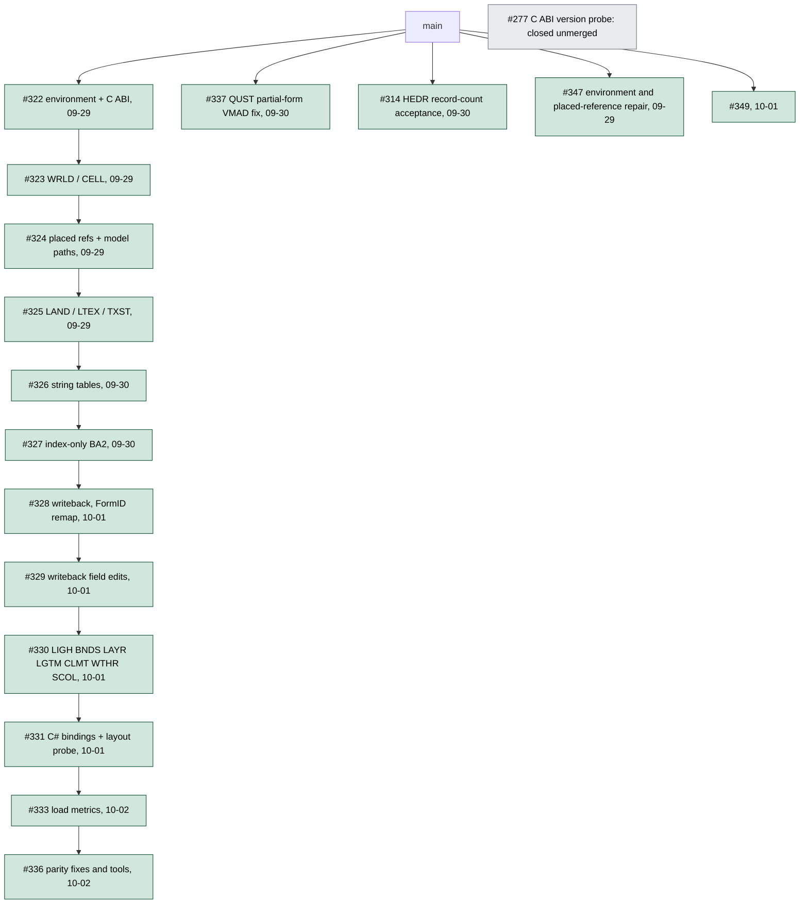
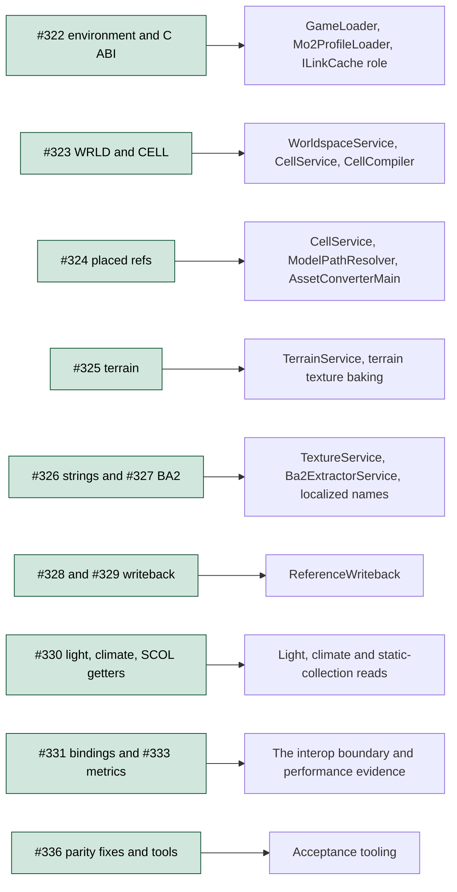
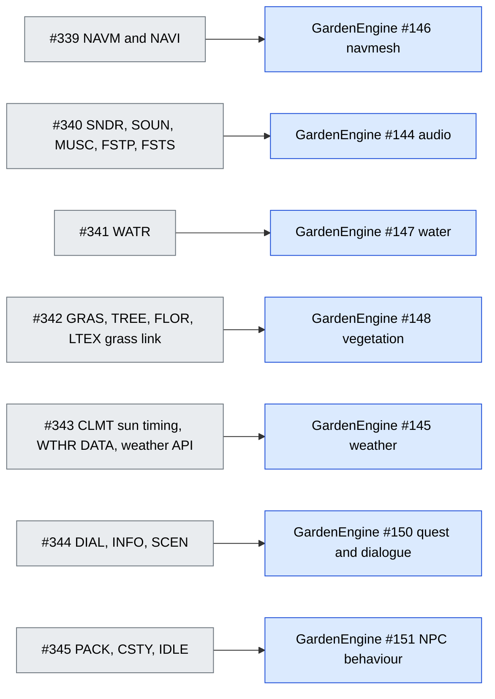

# Radicle for GardenEngine (Mutagen replacement)

Driver: [GardenEngine #114](https://git.nomadicinteractive.dev/garden-engine/GardenEngine/issues/114). GardenEngine reads plugins through a vendored Mutagen (`GameLoader`, `Mo2ProfileLoader`, `CellService`, `WorldspaceService`, `TerrainService`, `ReferenceWriteback`, `ModelPathResolver`, `TextureService`, `Ba2ExtractorService`, `CellCompiler`, `AssetConverterMain`). **Done in GardenEngine as of 2026-10-03:** the game project now reads plugins through Radicle behind the stable C ABI plus a narrow C# interop layer, and no longer references Mutagen (a verbatim Mutagen copy stays in GardenEngine's parity tests only). It was done one capability at a time, failing closed on anything unproven. See the GardenEngine page [Radicle-Integration](https://git.nomadicinteractive.dev/garden-engine/GardenEngine/wiki/Radicle-Integration.-). Tracking milestone: "Radicle - GardenEngine parity (retire Mutagen)" (id 34).

Both paths existed side by side during the move. After the migration GardenEngine's parity tests compare Radicle against Mutagen on real data: 13 of 13 passed on 2026-10-03 (98 minutes, profile Fallen World, local run, not CI).

## The stack (all merged)

Updated **2026-10-03**. The twelve slices were stacked pull requests, each based on the previous one. They merged into `main` in order between **2026-09-29 and 2026-10-02**, and GardenEngine pinned the result: [GardenEngine PR #130](https://git.nomadicinteractive.dev/garden-engine/GardenEngine/pulls/130) (merged 2026-10-03) builds Radicle at GARDEN-TOOLS `main` commit `2f9d4f51`, Radicle C ABI 3.

Merge dates are from each pull request page. #348 merged into a work branch rather than `main`. #335 (Radicle MSVC Debug CI) and #332 (`<algorithm>` include fix) were still open when this was checked and are not part of the stack.

## What each slice replaces

| Slice | Radicle surface | GardenEngine code it stands in for (from #114) |
| --- | --- | --- |
| #322 | `Environment`: ordered plugin loading, winner and all versions by FormKey, EditorID lookup, per-signature enumeration, plugin info, generic record metadata; `radicle_env_*` C ABI | `GameLoader`, `Mo2ProfileLoader`, the `ILinkCache` role |
| #323 | WRLD, CELL hierarchy, top cell, exterior/interior cells, merged cell children, winning landscape | `WorldspaceService`, `CellService`, `CellCompiler` |
| #324 | REFR/ACHR and traps, all placed-ref fields, model-path resolution | `CellService`, `ModelPathResolver`, `AssetConverterMain` |
| #325 | `decode_landscape` (heights, normals, colours, layers, VTXT), LTEX/TXST, diffuse walk | `TerrainService`, terrain texture baking |
| #326-#327 | string tables and localized names; BA2 index/extraction with asset precedence | `TextureService`, `Ba2ExtractorService`, localized name lookups |
| #328-#329 | override creation, transactional field edits, FormID remap | `ReferenceWriteback` |
| #330 | LIGH, BNDS, LAYR, LGTM, CLMT `WLST`, WTHR `NAM0` colours and `FNAM` fog, SCOL parts | light, climate and static-collection reads |
| #331, #333 | C# bindings with a layout probe; load metrics | the interop boundary; performance evidence |
| #336 | fixes found by the 644-plugin parity runs, plus `radicle_parity_dump` / `radicle_parity_writeback` | acceptance tooling |

The same table as a graph, from the GardenEngine consumer back to the slice that replaces it:

## Evidence recorded in the PRs (as of 2026-10-02)

- Cumulative #322-#333 stack, Windows clang-cl 19.1.5, Debug, `/W4 /WX`: **587 passed, 25 skipped, 0 failed** (612 CTest entries) (#330, 2026-09-26). Not a build of each PR head on its own.
- Installed game (Fallout 4 1.11.240): loaded 7 masters, 481,949,992 bytes, 2,192,230 records and 21 archives in about 61.7 s, peak RSS about 6.15 GB (#330).
- Parity runs (#336): versions, cells, placed refs, worlds, LAND and names match Mutagen row for row except two chains where Mutagen invents records; Radicle opens all 414 archives where Mutagen fails on 109; all 10 written references decode identically (only difference: a `-0.0` teleport rotation Radicle preserves). Local MSVC build ctest 615/615 (real-data tests skipped).
- CI: Forgejo runs on stack heads were "waiting" when the PR descriptions were last updated; no exact-head CI pass is claimed in those descriptions.

## Not covered yet (filed as issues)

| Gap | Feeds GardenEngine | Issue |
| --- | --- | --- |
| NAVM / NAVI geometry | #146 navmesh | [#339](https://git.nomadicinteractive.dev/GARDEN/GARDEN-TOOLS/issues/339) |
| SNDR / SOUN / MUSC / FSTP / FSTS | #144 audio | [#340](https://git.nomadicinteractive.dev/GARDEN/GARDEN-TOOLS/issues/340) |
| WATR | #147 water | [#341](https://git.nomadicinteractive.dev/GARDEN/GARDEN-TOOLS/issues/341) |
| GRAS / TREE / FLOR, LTEX grass link | #148 vegetation | [#342](https://git.nomadicinteractive.dev/GARDEN/GARDEN-TOOLS/issues/342) |
| CLMT sun timing, WTHR `DATA`, stable weather API | #145 weather | [#343](https://git.nomadicinteractive.dev/GARDEN/GARDEN-TOOLS/issues/343) |
| DIAL / INFO / SCEN | #150 quest and dialogue | [#344](https://git.nomadicinteractive.dev/GARDEN/GARDEN-TOOLS/issues/344) |
| PACK / CSTY / IDLE | #151 NPC behaviour | [#345](https://git.nomadicinteractive.dev/GARDEN/GARDEN-TOOLS/issues/345) |

Already on `main` and not part of the stack: QUST stages, objectives and aliases with real-plugin tests, and a read-only WTHR decoder marked `CONCEPT-LEVEL / RE-VERIFIED`.

## Risks

- **Stack depth (resolved).** The twelve linked branches all merged between 2026-09-29 and 2026-10-02.
- **Mutagen removal (done for the game project).** Remaining items are the proof points GardenEngine #114 still tracks, such as next-generation BA2 archives, which the BA2 parity test may not have covered separately.
- **New readers.** NAVM, sound, WATR, grass, weather timing, dialogue and package semantics are still open (#339 to #345) and block the GardenEngine systems listed above.
- **Licence.** GardenEngine's GPL-3.0 rationale is the vendored Mutagen; see GardenEngine audit #143.
