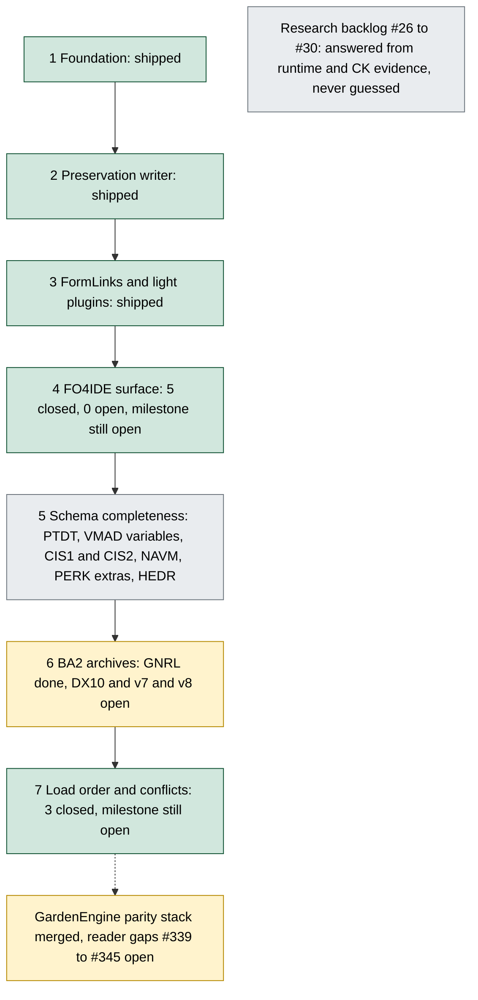
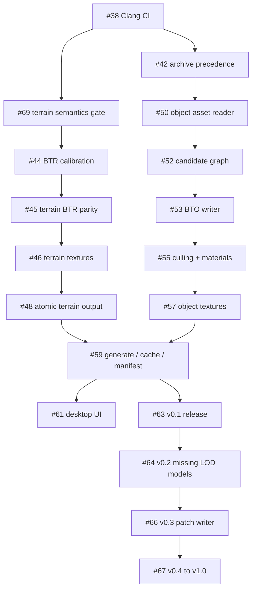
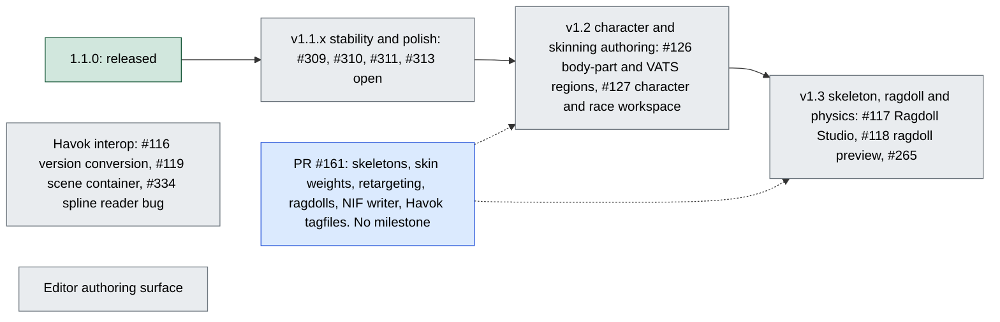
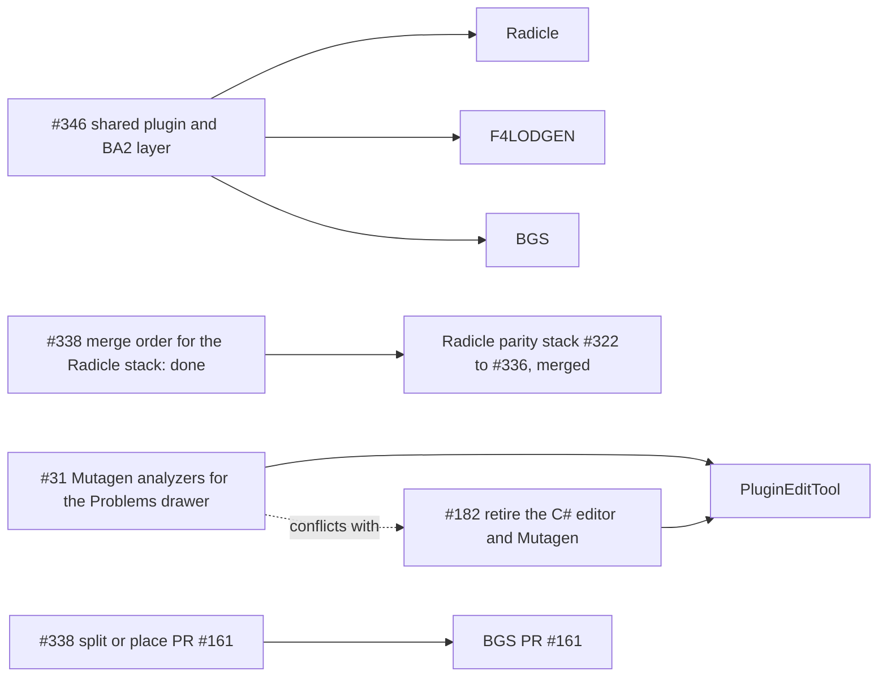

# Roadmap

Board: [GARDEN-TOOLS Roadmap](https://git.nomadicinteractive.dev/GARDEN/GARDEN-TOOLS/projects/2). Columns are tools and areas; status is on each card (`status:*`, `p0`-`p3`, open/closed). Findings and cleanup checklist: [#338](https://git.nomadicinteractive.dev/GARDEN/GARDEN-TOOLS/issues/338).

## Milestones

| Tool | Milestone | Scope |
| --- | --- | --- |
| Radicle | Phase 1-3 (closed) | Foundation, preservation writer, FormLinks and light plugins: shipped |
| Radicle | Phase 4 FO4IDE surface | 0 open, 5 closed, still open; `Radicle/ROADMAP.md` still calls it "now" |
| Radicle | Phase 5 Schema completeness | PTDT/PDTO, VMAD variables, CIS1/2, NAVM, PERK extras, HEDR (#15, #19, #314) |
| Radicle | Phase 6 BA2 archives | DX10, next-gen v7/v8 (#21) |
| Radicle | Phase 7 Load order and conflicts | 0 open, 3 closed, still open |
| Radicle | Research backlog | #26-#30, must be answered from runtime/CK evidence |
| Radicle | GardenEngine parity (retire Mutagen) | delivered: the 12-PR stack merged 2026-09-29 to 2026-10-02 and GardenEngine #130 merged 2026-10-03; open: reader gaps #339-#345; see [Radicle-GardenEngine-Parity](https://git.nomadicinteractive.dev/GARDEN/GARDEN-TOOLS/wiki/Radicle-GardenEngine-Parity.-) |
| PluginEditTool | Native rewrite and hardening | #86, #182 (retire C#), #82, #43, #37, #41, #77, #81; PRs #316, #318-#321 |
| PluginEditTool | xEdit parity | #275, #287 umbrellas, #283, #285, #83, #84, #40, #39, #33, #32, #56; PRs #312, #315, #317 |
| PluginEditTool | CK-free precombine and previs | #80, #34, #35 |
| PluginEditTool | Expansion tools | #47 Nexus lookup, #49 F4SE DLL audit, #51 dialogue validator, #78 Papyrus fidelity |
| BGS | v1.1.x, v1.2, v1.3, Editor surface, Havok interop | see below |
| F4LODGEN | v0.1, v0.2, v0.3, v0.4-v1.0 | see below |

## Radicle phases

Phase order is the roadmap's numbering, not a strict dependency chain. `Radicle/ROADMAP.md` still marks phase 4 as "now" and phases 6 and 7 as "later", while the Radicle README lists the BA2 GNRL reader and the load-order and conflict graph as implemented. The roadmap file is behind the README, and the milestone counts above are from the board.

## F4LODGEN chain

`F4LODGEN/docs/ROADMAP.md` (last updated 2026-08-18) numbers its issues #1-#19 from before the move. Current numbers in this repository:

| Roadmap # | Current # | Phase |
| --- | --- | --- |
| 1 | [#36](https://git.nomadicinteractive.dev/GARDEN/GARDEN-TOOLS/issues/36) | v0.1 release tracker |
| 2 | #38 | 0: Clang CI gate |
| 3 | #42 | 0: archive precedence |
| 19 | #69 | 1: terrain source semantics parity gate |
| 4, 5 | #44, #45 | 2: BTR calibration and parity |
| 6, 7 | #46, #48 | 3: terrain textures, atomic output |
| 8, 9 | #50, #52 | 4: object asset foundation, candidate graph |
| 10, 11 | #53, #55 | 5: BTO writer, culling and materials |
| 12 | #57 | 6: object texture compiler |
| 13 | #59 | 7: generate, cache, manifest |
| 14 | #61 | 8: desktop UI |
| 15 | #63 | 9: v0.1 acceptance and release |
| 16, 17, 18 | #64, #66, #67 | v0.2, v0.3, v0.4-v1.0 |

Edges are the roadmap's own "Dependency chain" section with numbers translated. The roadmap says phases 0-2 are in progress, but no open pull request mentions F4LODGEN, so the true state needs confirming.

## BGS

Milestones (existing): v1.1.x stability and polish (1.1.0 is shipped; #309, #310, #311, #313 are open), v1.2 character and skinning authoring (#126 body-part/VATS regions, #127 character/race workspace), v1.3 skeleton, ragdoll and physics (#117 Ragdoll Studio, #118 ragdoll preview, #265), Havok interop (#116 semantic version conversion, #119 scene container, #334 spline reader bug), Editor authoring surface. PR [#161](https://git.nomadicinteractive.dev/GARDEN/GARDEN-TOOLS/pulls/161) bundles skeletons, skin weights, retargeting, ragdolls, a NIF writer and Havok tagfiles across v1.2 and v1.3 and has no milestone.

Version order follows the milestone names; the board states no dependencies between the BGS milestones, so Havok interop and the editor surface are drawn unconnected.

## Open decisions

| Decision | Issue |
| --- | --- |
| Adopt `Mutagen.Bethesda.Analyzers` for the Problems drawer, or not, given #182 retires Mutagen | #31 |
| Split or place PR #161 | #338 |
| Merge order for the Radicle stack | #338 (resolved: merged in order 2026-09-29 to 2026-10-02) |
| Shared plugin and BA2 layer across tools | [#346](https://git.nomadicinteractive.dev/GARDEN/GARDEN-TOOLS/issues/346) |

The dotted edge is the tension noted in the table: adopting Mutagen analyzers is questionable while #182 retires Mutagen.
